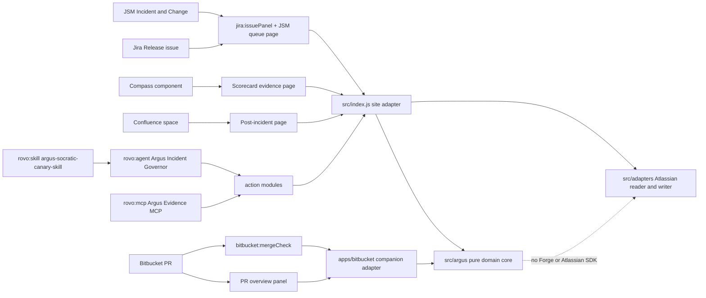
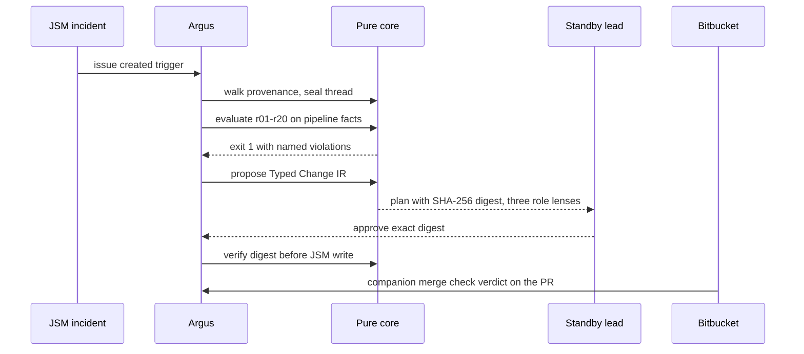

# Argus for Jira, JSM and Bitbucket

[](https://github.com/upgradedev/argus-atlassian/actions/workflows/ci.yml)
[](LICENSE)

Argus links JSM incidents to linked Bitbucket work, fires a synthetic canary to expose fake-green gates, and returns a re-verified repair patch.

For Dimitris Lagos, SRE and Release Lead on JSM incident standby at a fintech engineering team. His P1 opens in Jira Service Management minutes after a Bitbucket Pipeline and a Jira Release showed all green. The green badge was the lie. Argus reads the exit codes under the badge.

**Try it with no account:** open the
[anonymous interactive demo](https://upgradedev.github.io/argus-atlassian/),
paste a `bitbucket-pipelines.yml`, and watch twenty deterministic rules
judge it in your browser. Nothing leaves the page.

## Contents

- [Status, read this before the claims](#status-read-this-before-the-claims)
- [How the verification works](#how-the-verification-works)
- [The twenty rules](#the-twenty-rules)
- [Architecture](#architecture)
- [Quickstart](#quickstart)
- [Install on your Atlassian site](#install-on-your-atlassian-site)
- [Zero egress and least privilege](#zero-egress-and-least-privilege)
- [Evidence](#evidence)
- [Well-Architected and EU AI Act notes](#well-architected-and-eu-ai-act-notes)
- [Repository layout](#repository-layout)

## Status, read this before the claims

| Surface | State today |
|---|---|
| Domain core (canary, change IR, evidence, provenance, receipts, standby, shield, rules r01-r20) | Implemented and tested. `node --test` gives 99 pass, 0 fail |
| Kill-test benchmark | Implemented. `node scripts/run_killtest_benchmark.js` gives rules accepted 20/20 on Argus synthetic fixtures. It is a fixture separation result, not a field measurement |
| Forge apps | Two installables over one core: the registered site app (`manifest.yml`) owns JSM, Jira, Compass, Confluence, and Rovo; the Bitbucket companion app root (`apps/bitbucket/`) owns the merge check. Forge rejects mixing Bitbucket workspace scopes with site scopes |
| Live Atlassian reads | Reader adapter implemented behind an injected client, including issue links and remote links labelled association rather than causality. Live exercise is part of the deployment UAT below |
| Governed writes | Typed Change IR proposals persist in Forge KVS. Standby assignment executes only when the human digest matches the stored plan, seals a receipt, and refuses replay |
| Verified repair | Argus rewrites supplied pipeline YAML and re-evaluates all rules before returning it as a patch. The Bitbucket companion merge check blocks a fake-green PR; automated repair-PR creation is adapter-tested but not yet exposed as a companion function |
| Teamwork Graph connector ingestion | Not implemented. The documented connector shape pairs with external fetch and an auth provider, which would break zero egress, so Argus walks issue and pull request links instead. Recorded as an open decision, not a quiet gap |
| Anonymous demo | Live as a static page (link above). It evaluates YAML you paste. It never connects to your site |

## How the verification works

The contract is an exit code, not an opinion.

1. A trigger fires on its own when a JSM incident or Jira issue is created
   or updated. Nobody has to ask.
2. The reader collects evidence and a provenance thread links incident to
   pipeline run to commit, sealed with SHA-256 so a broken link shows.
3. The Elenchos rules evaluate pipeline facts. A candidate repair must
   first pass the Socratic Kill-Test: a violating fixture exits 1, a clean
   fixture exits 0. A check that passes the violating fixture, or fails
   clean traffic, is thrown out before a human sees it.
4. Repairs are proposed as Typed Change IR, never as raw shell. Shell
   syntax in any field is rejected at construction.
5. The one write path runs only after a human approves the exact plan and
   its SHA-256 digest matches. The approval receipt is Merkle sealed and
   renders as plain text, a spoken sentence, and a Braille-ready line.
6. If the primary responder misses the ack window, the standby roster
   fails over deterministically, one step per window.

## The twenty rules

| Rule | Fails when |
|---|---|
| r01 | Test exit code masked (`\|\| true`) |
| r02 | Test step allowed to fail |
| r03 | Tests skipped |
| r04 | No test step in the pipeline |
| r05 | Passing with no tests allowed |
| r06 | Coverage gate missing or below 80 |
| r07 | No lint step in the pipeline |
| r08 | Lint step allowed to fail |
| r09 | No security scan step |
| r10 | Security scan cannot fail the build |
| r11 | Deploy not gated on tests |
| r12 | Production deploy without manual approval |
| r13 | Required merge checks not enforced |
| r14 | Secret material detected in code |
| r15 | No dependency lockfile |
| r16 | Dependency install not frozen |
| r17 | Cache key ignores the lockfile |
| r18 | Unpinned container image |
| r19 | No job timeout set |
| r20 | Success status forced, not from exit codes |

Each rule earned its place by separating fixtures through the kill-test
machine. The badge-only check a status page uses is thrown out on all
twenty fixtures in the same benchmark. That gap is the product.

## Architecture





## Quickstart

Prerequisites: Node 20 or newer, Python 3 with PyYAML for the manifest
gate. No install is needed for the tests themselves.

```bash
git clone https://github.com/upgradedev/argus-atlassian
cd argus-atlassian
node --test
```

Expected: `# pass 99` and `# fail 0` (measured 2026-11-04). Under a minute.

```bash
node scripts/run_killtest_benchmark.js
```

Expected tail: `rules accepted: 20/20`, `badge-only check thrown out: 20/20`,
median full validation under 1 ms on the measuring machine. Your machine
will differ; the count must not.

```bash
pip install pyyaml
python scripts/check_manifest.py
```

Expected: nine `PASS` lines and one `USER-GATED` line for the Bitbucket
companion `app.id`. Exit code 0. The gated line is a named manual step,
never a pass.

To rebuild the demo page after a domain change:

```bash
node scripts/build_demo.js
```

It rewrites `demo/`, `docs/`, and `static/argus-ui/build/` from the same
source, so the browser and the panel cannot drift.

## Install on your Atlassian site

Argus ships as two Forge installables over one codebase. Forge does not
allow Bitbucket workspace scopes and Jira site scopes in the same app,
so pretending otherwise would not deploy.

1. Create a free developer site at
   [go.atlassian.com/cloud-dev](https://go.atlassian.com/cloud-dev) with
   Jira, Jira Service Management, and Confluence, plus a Bitbucket
   workspace for the companion app.
2. Install the Forge CLI and log in: `npm install -g @forge/cli`,
   then `forge login`.
3. Site app: `manifest.yml` already carries the registered Argus site
   app id. Run `forge deploy`, then `forge install` into Jira/JSM,
   Compass, and Confluence as each product is available. Consent shows
   13 scopes and zero external domains.
4. Bitbucket companion: from `apps/bitbucket/`, run `forge register`
   once, then deploy and install it into the Bitbucket workspace. Its
   consent shows six scopes, including repository admin because
   Bitbucket requires it even to read branch restrictions.
5. In Bitbucket workspace settings, enable Custom merge checks and mark
   Argus Socratic Canary required where you want it to block merges.
6. Open any JSM incident. The Argus panel runs the seed canary on an
   empty site, and the Rovo agent accepts pasted pipeline YAML through
   its kill-test action for an immediate rule verdict.

## Zero egress and least privilege

The manifest declares no external domains, no remotes, no providers, no
Connect modules, and no web triggers. Storage is Forge hosted storage
only. That is stricter than the Runs on Atlassian badge minimum, which
permits analytics egress. `scripts/check_manifest.py` fails the build if
any egress surface returns. Run it against a manifest with a `remotes:`
block added and watch it exit 1; a gate that cannot fail is decoration.

Within each installable, Forge grants one union scope set, so the
Reader, Evaluator, and Writer split is also enforced in code: the
reader adapter throws on write attempts, and the writer runs only
after the approval digest check. Both behaviors have tests that fail
if the guard is removed. Keeping Bitbucket scopes in a companion app
means the JSM/Rovo app never receives repository admin rights.

GDPR note: Argus reads issue, pull request, and pipeline metadata inside
the installed Atlassian tenancy, stores nothing outside it, and has no
vendor server to receive personal data. Account ids appear in evidence
records because responders are account ids. No personal data leaves the
tenancy, because no egress path exists in the manifest.

## Evidence

Every number below names its command. Re-run them; do not take our word.

| Claim | Command | Result on 2026-11-03 |
|---|---|---|
| Core and adapter tests | `node --test` | 99 pass, 0 fail |
| Rule separation | `node scripts/run_killtest_benchmark.js` | 20/20 accepted; badge-only check thrown out 20/20; scope is synthetic fixtures |
| Manifest shape | `python scripts/check_manifest.py` | 0 FAIL, 1 USER-GATED (Bitbucket companion `app.id`) |
| Python twin still green | `python -m unittest discover` in the sister core | 39 tests OK; shared digests pinned in this repo tests |

## Well-Architected and EU AI Act notes

Well-Architected, mapped to Forge instead of recited. Operational
excellence: every gate is a script that prints its counts. Security: zero
egress plus digest-guarded writes. Reliability: standby failover is a
pure function of elapsed seconds. Performance efficiency: the full rule
validation medians under 1 ms locally. Cost: Forge hosted, no vendor
infrastructure. Sustainability: no always-on server exists to idle.

EU AI Act (Regulation EU 2024/1689), by article, with the gap kept in.

| Article | What Argus does | Residual gap |
|---|---|---|
| 10 (data) | Inputs are pipeline and issue facts inside the tenancy; rules are deterministic, no training data | Heuristic facts extraction can misread unusual YAML and must stay labelled as extracted facts |
| 13 (transparency) | Every verdict names the rules, the exit codes, and whether evidence was live, pasted, or seed | The Rovo agent wording is model generated around those facts and can still phrase them badly |
| 14 (human oversight) | Write paths need a human supplied digest matching a stored plan; proposals never self-approve; executions refuse replay and seal receipts | The digest proves plan integrity, not by itself the legal identity of the approver |
| 15 (accuracy) | Rules must separate fixtures in the kill-test before they exist for users; benchmark ships in repo | Fixture separation is not field accuracy; no customer pipeline corpus has been measured |
| 50 (disclosure) | Panels and demo state plainly when a result is seed or not connected | Marketplace listing copy still has to carry the same labels through review |

## Repository layout

```text
manifest.yml            site Forge app: zero egress, Rovo pair plus skill
apps/bitbucket/         Bitbucket companion app: merge check and PR panel
src/index.js            site Forge handlers, seed fallbacks, live routing
src/governance.js       stored plans, digest verification, receipts, replay guard
src/resolver.js         @forge/resolver construction with a test fallback
src/forge_events.js     documented Forge event parsers and merge-check replies
src/argus/              pure domain core, zero vendor SDK imports
src/adapters/           Atlassian, Compass, Forge client, KVS plan store
skills/argus-canary/    Agent Skills SKILL.md, also the rovo:skill source
tests/                  node:test suites for core, rules, handlers, adapters
scripts/                kill-test benchmark, manifest gate, demo builder
demo/  docs/  static/   generated single-file demo (do not edit by hand)
```

License: MIT. See [LICENSE](LICENSE).

